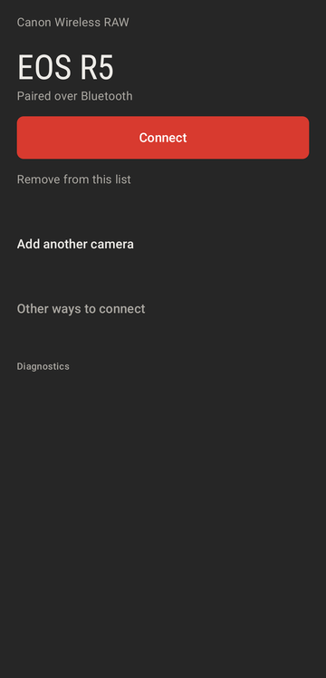
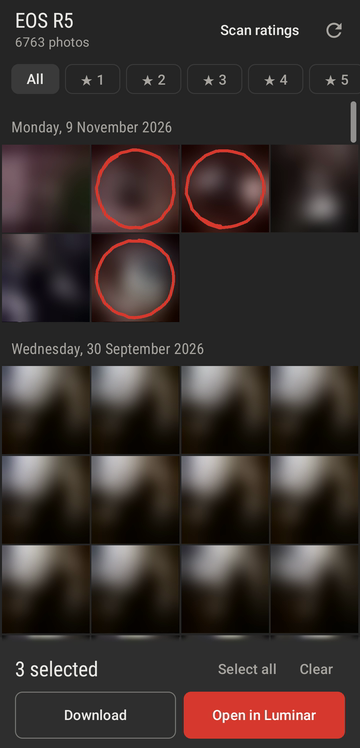
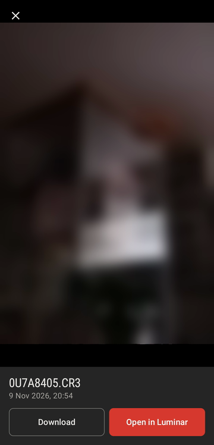
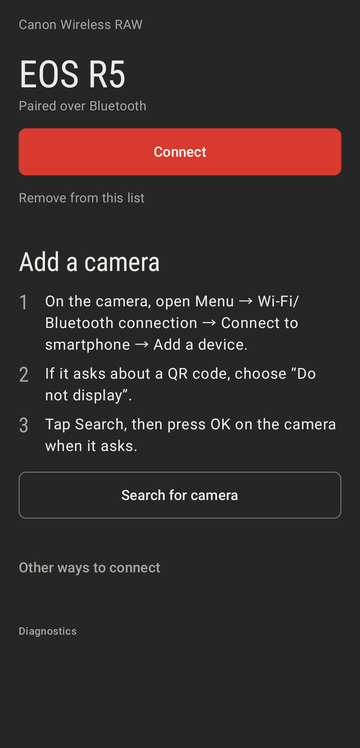
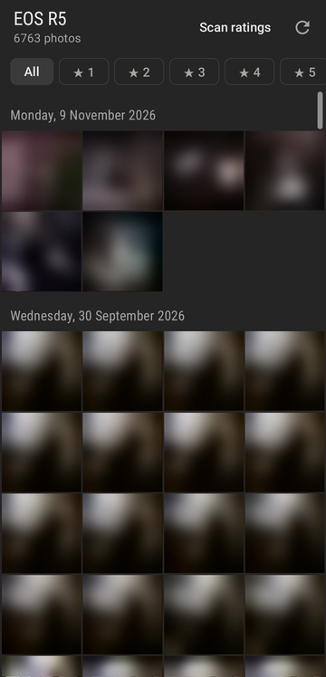
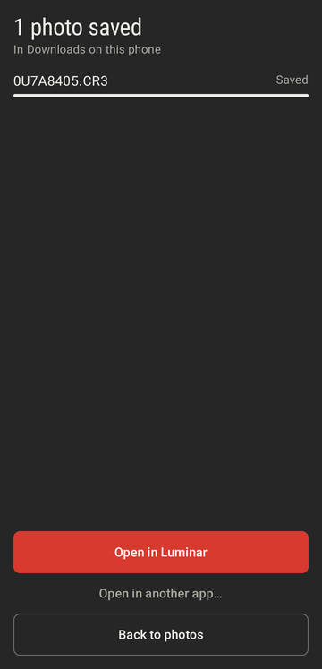

# Canon Wireless RAW for Android

Pull RAW photos (CR3) off a Canon EOS camera over Wi-Fi and hand them to your editor. No Canon
account, no cloud, no Canon app. Pair the camera once over Bluetooth. After that, one tap wakes
it, joins its Wi-Fi and shows the card.

<p>
  
  
  
</p>

## What it does

- **Connects with one tap.** The app pairs with the camera over Bluetooth once. Each connect then
  asks the camera over Bluetooth to start its Wi-Fi, joins it and opens the card. You never type
  an IP address or a Wi-Fi password.
- **Shows the whole card, grouped by day.** Newest photos come first, with a header per day. Drag
  the handle on the right edge to jump to a date. The app keeps each camera's file list, so a
  reconnect shows the full gallery at once.
- **Shows new shots live.** A photo you take while connected appears at the top within a second,
  in a row of its own, so the photos you are looking at don't move.
- **Filters by your in-camera rating.** The star chips use the rating you set on the camera.
  **Scan ratings** reads the ratings of the whole card. You can stop it at any time.
- **Zooms into the preview.** Tap a photo to see the camera's full-HD preview with pinch zoom.
- **Downloads or opens in your editor.** Long-press marks a photo with a red loop. **Download**
  saves the originals to the phone. **Open in Luminar** (or the app you picked the first time)
  downloads the RAWs and opens them in that app in one step.
- **Keeps the connection.** Switching to your editor or turning the screen off doesn't drop the
  camera. A notification shows while the session is open. If the camera stops answering, the app
  reconnects by itself.
- **Handles several cameras.** Each paired camera gets its own entry.

## Supported cameras

Tested on the **Canon EOS R5**. The app speaks Canon's own smartphone protocol: Bluetooth pairing,
Wi-Fi handover over Bluetooth, then PTP/IP. Other EOS bodies with Bluetooth (for example EOS R,
R6, RP, M50) likely work. If you try one, please open an issue with the result.

Cameras without Bluetooth can still connect in EOS Utility mode by IP address. See
[Other ways to connect](#other-ways-to-connect).

## Pair your camera

1. On the camera, open **Menu → Wi-Fi/Bluetooth connection → Connect to smartphone → Add a
   device**. If it asks about a QR code, choose **Do not display**.
2. In the app, tap **Search for camera**. Allow Bluetooth when Android asks.
3. On the camera, press **OK** when it asks whether to connect to your phone.
4. Press **MENU** on the camera to leave the pairing screen.

The camera now shows up in the app's list. Canon cameras usually keep one smartphone pairing. If
Canon's Camera Connect app stops connecting afterwards, pair it again.



## Connect and download

1. Turn the camera on with Bluetooth enabled.
2. Tap **Connect** next to the camera. The first time, Android asks whether to join the camera's
   Wi-Fi. Allow it.
3. Wait for the gallery. On an R5 this takes about 10 seconds.
4. Tap a photo to view it, or long-press photos to mark them.
5. Tap **Download** to save the originals, or **Open in …** to send them to your editor.

The first time you use **Open in …**, Android shows its app picker. The app remembers your pick
and names the button after it. To switch apps, tap **Open in another app…** after a download.
Downloads land in the phone's **Downloads** folder.

While connected, the camera's Wi-Fi replaces your phone's Wi-Fi: most phones allow one Wi-Fi
network at a time. Mobile data keeps working for other apps. The session ends when you go back to
the camera list, or 5 minutes after you leave the app.

<p>
  
  
</p>

## Other ways to connect

For cameras without Bluetooth, or if you already use EOS Utility pairing:

1. On the camera, open **Menu → Wi-Fi/Bluetooth connection → Remote control (EOS Utility) → Add a
   device to connect to**.
2. On the phone, join the Wi-Fi network the camera opens. On a shared home network, make sure both
   are on it.
3. In the app, open **Other ways to connect**, enter the camera's IP address and tap **Connect by
   IP**. In the camera's own network the address is usually `192.168.1.2`.
4. Accept the confirmation on the camera. The app keeps retrying for a minute, so there is no rush.

To skip the manual Wi-Fi join, save the camera's Wi-Fi name and password under **Wi-Fi name and
password…** and use **Join saved Wi-Fi and connect**.

## Troubleshooting

- **The search finds no camera.** The camera has to show its pairing screen (step 1 of
  [Pair your camera](#pair-your-camera)). An already paired camera is found when its Bluetooth is
  on.
- **"Connection lost" in the gallery.** Tap **Reconnect**. If that fails too, switch the camera off
  and on, then connect again.
- **The camera shows "Err 11" or "Connection target not found".** The camera is in smartphone mode
  but doesn't know this phone. Pair it first.
- **Open in … lists no editor.** The editor has to accept shared images. Luminar, Lightroom and
  Snapseed do.

## Permissions

| Permission | Why |
|---|---|
| `BLUETOOTH_SCAN`, `BLUETOOTH_CONNECT` (Android 12+) | Pair with the camera and ask it to start its Wi-Fi. |
| `BLUETOOTH`, `BLUETOOTH_ADMIN`, `ACCESS_FINE_LOCATION` (Android 11 and older) | The same on older Android, where Bluetooth scanning needs location. |
| `INTERNET`, `ACCESS_NETWORK_STATE`, `ACCESS_WIFI_STATE`, `CHANGE_NETWORK_STATE` | Join the camera's Wi-Fi and talk PTP/IP to it. |
| `FOREGROUND_SERVICE`, `FOREGROUND_SERVICE_CONNECTED_DEVICE` | Keep the camera's Wi-Fi while you use another app. |
| `POST_NOTIFICATIONS` (Android 13+) | Show the "Connected to …" notification. Optional. |

No tracking, no analytics, no accounts. The app only talks to your camera.

## Building

Requirements: JDK 17 or newer, the Android SDK, NDK 27.2 (pinned in `app/build.gradle.kts`) and
CMake 3.22.

```bash
export JAVA_HOME=/path/to/jdk17+   # e.g. "$(brew --prefix openjdk@21)/libexec/openjdk.jdk/Contents/Home"
./gradlew assembleDebug            # app/build/outputs/apk/debug/app-debug.apk
./gradlew testDebugUnitTest        # JVM unit tests
tools/ptpip-harness/run.sh         # native PTP/IP code against a fake camera (needs a C compiler and python3)
```

The debug build installs as `de.bestora.canonwirelessrawandroid.debug`, next to a release build.

## How it works

The connection follows Canon's smartphone protocol, as Canon's Camera Connect app uses it:

1. **Bluetooth.** The app registers itself with the camera once: a pairing request the user
   confirms on the camera, then a per-install GUID and the phone's name. For each connect it asks
   the camera for its Wi-Fi details (network name, password, IP address) and tells it to start
   its Wi-Fi (`app/src/main/java/de/bestora/canonwirelessrawandroid/ble/`).
2. **Wi-Fi.** The app joins the camera's network with `WifiNetworkSpecifier` and binds itself to
   it. A foreground service keeps the network while the app is in the background.
3. **PTP/IP.** The app opens a PTP/IP session over TCP port 15740 with the same GUID, session ID
   `0x41` and EOS remote mode `0x15`, and sends Canon's keep-alive (`0x902F`) every 5 seconds.
   Without these the camera keeps showing "please wait" and drops the connection after a minute.

The native PTP layer is [libpict](https://github.com/petabyt/libpict) (Apache-2.0), vendored
under `app/src/main/cpp/libpict/` with two documented fixes in [`PATCHES.md`](PATCHES.md). A
thin JNI bridge (`app/src/main/cpp/ptp_jni.c`) exposes it to Kotlin. `CameraRepository` owns the
session: it reconnects silently when a call fails, polls the camera's events for new photos and
caches each camera's file list.

Ratings, thumbnails and previews come straight from the CR3 file. `Cr3Container` walks the ISO-BMFF
boxes: `THMB` for the thumbnail, `PRVW` for the full-HD preview, the XMP box for `xmp:Rating` and
`CMT1` for the orientation. A plain JPEG-marker scan would misfire on Canon's makernote bytes.

## Credits

- [petabyt/libpict](https://github.com/petabyt/libpict): the PTP/PTP-IP library
- [libgphoto2](https://github.com/gphoto/libgphoto2): reference for Canon EOS PTP operations and events
- [julianschroden.com](https://julianschroden.com/): a clear write-up of Canon's PTP/IP handshake
- [lclevy/canon_cr3](https://github.com/lclevy/canon_cr3): CR3 file structure
- [gkoh/furble](https://github.com/gkoh/furble): Canon Bluetooth basics

The Bluetooth handover and the session details were worked out by observing how Canon's Camera
Connect app talks to the camera, for interoperability.

## License

Apache License 2.0, see [`LICENSE`](LICENSE). The vendored
[libpict](https://github.com/petabyt/libpict) is also Apache-2.0; its license is kept at
[`app/src/main/cpp/libpict/LICENSE`](app/src/main/cpp/libpict/LICENSE).
